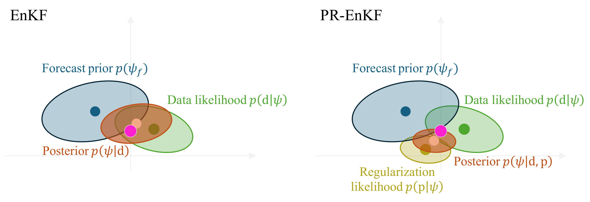
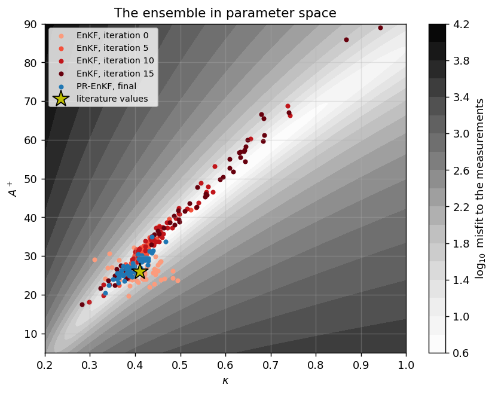

# PR-EnKF: Parameter-Regularised Ensemble Kalman Filter

[](https://github.com/EmanueleBombardi/pr-enkf/actions/workflows/tests.yml)
[](https://colab.research.google.com/github/EmanueleBombardi/pr-enkf/blob/main/tutorials/01_channel_flow.ipynb)
[](LICENSE)
[](https://arxiv.org/abs/2607.03571)

The PR-EnKF augments the standard Ensemble Kalman Filter with literature-consistent
parameter values $\mathbf{p}$, assimilated as pseudo-observations alongside the
measurements $\mathbf{d}$. It infers the parameters of physical models (e.g. turbulence
or chemical-kinetics closures) from sparse, noisy data while keeping them physically
consistent where the data provide limited information.

<p align="center"></p>

Method and implementation details: [docs/theory.md](docs/theory.md) ·
Paper: [arXiv:2607.03571](https://arxiv.org/abs/2607.03571)

## What's in this repository

| | |
|---|---|
| [`pr_enkf/`](pr_enkf) | Compact Python implementation of the EnKF and PR-EnKF |
| [`tutorials/01_channel_flow.ipynb`](tutorials/01_channel_flow.ipynb) | Step-by-step tutorial; runs in under a minute |
| [`docs/theory.md`](docs/theory.md) | Algorithm, implementation choices, Python ↔ C++ correspondence |
| [`openfoam/`](openfoam) | General-purpose OpenFOAM implementation: each ensemble member is a full simulation; supports multiple domains, multiple observed fields, parameter clustering and HPC execution |

## Example: why the literature values matter

The tutorial infers three parameters of a mixing-length model of turbulent channel
flow ($\kappa$, $A^+$, $\lambda$) from 5 noisy velocity measurements at
$Re_\tau = 550$, and tests the result at $Re_\tau = 180$ and $5200$. With few
measurements, the data constrain only a combination of $\kappa$ and $A^+$: the EnKF
drifts along this ridge to non-physical values, while the PR-EnKF stays in the
physically plausible region.

<p align="center"></p>

Over 30 independent noise realisations ($\sigma_d = 0.3$, 50 members, 30 iterations):

| Measurements | Filter | Failed runs | Misfit to data | Error, $Re_\tau$=550 | Error, $Re_\tau$=180 | Error, $Re_\tau$=5200 | 95% coverage, $Re_\tau$=5200 |
|---|---|---|---|---|---|---|---|
| 5 sparse | EnKF | 6/30 | 0.27 | 0.29 | 0.66 | 1.28 | 67% |
| 5 sparse | **PR-EnKF** | **0/30** | 0.31 | **0.25** | **0.35** | **0.35** | **97%** |
| 8 outer | EnKF | 0/30 | 0.29 | 0.20 | 0.70 | 1.43 | 37% |
| 8 outer | **PR-EnKF** | **0/30** | 0.34 | **0.19** | **0.32** | **0.53** | **81%** |

Errors are RMSE in $U^+$ against the truth; with the literature values they are 0.59,
0.55 and 0.68. Averages are over successful runs. Reproduce with
`python scripts/statistics.py`.

The EnKF fits the noisy data more closely, yet at unseen conditions it performs worse
than the model with literature values, and its uncertainty is overconfident. The
PR-EnKF improves the predictions at all conditions, with approximately correct
coverage.

## Quick start

```bash
git clone https://github.com/EmanueleBombardi/pr-enkf.git
cd pr-enkf
pip install -e ".[tutorial]"
jupyter notebook tutorials/01_channel_flow.ipynb
```

Or run the tutorial in the browser: [](https://colab.research.google.com/github/EmanueleBombardi/pr-enkf/blob/main/tutorials/01_channel_flow.ipynb)

Using it with your own model requires a forward function `alpha -> q`:

```python
from pr_enkf import run

result = run(forward, p=[0.41, 26.0, 0.09], gamma=[0.1, 0.1, 0.1],
             d=measurements, sigma_d=0.3, n_ens=50, n_iter=30,
             regularise=True)       # regularise=False -> standard EnKF

alpha_final = result["alpha"][-1]   # (n_alpha, n_ens) final parameter ensemble
```

## Citation

If you use this code, please cite:

> E. Bombardi, A. Nóvoa, L. Magri, A. Parente, "Transferable inference of turbulence
> models for urban flows with the Parameter-Regularised Ensemble Kalman Filter",
> arXiv:2607.03571 (2026).

```bibtex
@article{bombardi2026prenkf,
  author  = {Bombardi, Emanuele and N{\'o}voa, Andrea and Magri, Luca and Parente, Alessandro},
  title   = {Transferable inference of turbulence models for urban flows with the
             {Parameter-Regularised Ensemble Kalman Filter}},
  journal = {arXiv preprint arXiv:2607.03571},
  year    = {2026}
}
```

## Acknowledgements

Developed at the Aéro-Thermo-Mécanique Laboratory, Université libre de Bruxelles.
This work is part of the MODELAIR project, which has received funding from the
European Union's Horizon Europe research and innovation programme under the
Marie Skłodowska-Curie grant agreement No 101072559.

## License

GPL-3.0. The OpenFOAM implementation is derived from OpenFOAM, distributed under GPL-3.0.
